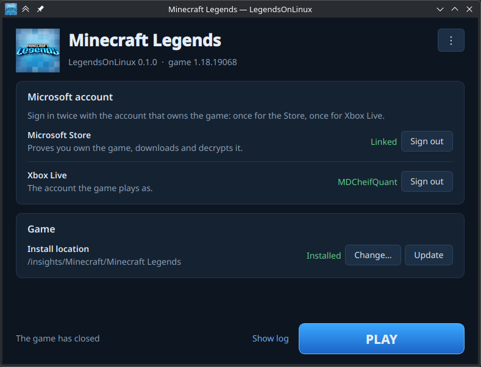

# LegendsOnLinux

Play **Minecraft Legends (Windows edition)** on Linux with the copy you own.

LegendsOnLinux signs in to your Microsoft account, downloads the game from
Microsoft's own servers (only if your account owns it), and runs it with a
patched [WineGDK](https://github.com/Weather-OS/WineGDK) engine. It also signs
the game in to Xbox Live.



> **Status: early.** The game reaches the main menu, signs in to Xbox Live
> and saves locally. Online multiplayer is untested. Saves stay on this PC and
> do **not** sync with your Xbox/Windows cloud saves.

## Why Minecraft Legends needs more than Proton

The Microsoft Store build of Legends is a **GDK ("Gamecore") title**, not a
UWP app. It depends on Microsoft's Gaming Runtime (`xgameruntime.dll`) for
Xbox sign-in, the Store license check and save games, and neither Wine nor
Proton provides it. WineGDK does, and LegendsOnLinux adds the two parts
Legends needs on top of it:

| Symptom without it | Cause | Fix (`engine/patches/`) |
|---|---|---|
| Stuck at the first loading bar | The Store license query always fails | `0001`: answer it with an active license |
| Stuck at "Loading, please wait" after sign-in | WineGDK has no XGameSave | `0002`: XGameSave on local storage |

## How it works

| Part | How |
|---|---|
| Ownership, licence, download | [xodus-cli](https://github.com/xodus-gaming/xodus) signs in as a Windows Store device and streams the package from the Xbox CDN. |
| Decryption | The game's executable stays encrypted on disk, as on Windows. `xodus-cli run` decrypts it into memory at every launch. |
| Xbox Live in the game | A Microsoft device-code sign-in. The launcher builds the Xbox Live token chain itself and hands it to WineGDK. |
| Engine | [BedrockOnLinux](https://github.com/Wyze3306/BedrockOnLinux)'s published WineGDK build, with `xgameruntime.dll` replaced by our build of the same source plus `engine/patches/` (published as a [release](https://github.com/mdx0111/LegendsOnLinux/releases/tag/xgameruntime-legends-1) of this repository). |
| Network | The game's `XCurl.dll` is swapped for an OpenSSL build, because Azure drops Wine's TLS. |

All downloaded components are pinned by SHA-256 in
`legends_on_linux/config.py`.

## Requirements

- x86-64 Linux with a Vulkan GPU driver
- Python ≥ 3.10 with `cryptography`, and `PySide6` for the launcher window
- `libwebkit2gtk-4.1` (for the Microsoft Store sign-in window)
- About 13 GB of disk space for the game, plus about 3 GB for the engine and runtime

On Fedora: `sudo dnf install python3-cryptography python3-pyside6 webkit2gtk4.1`
On Debian/Ubuntu: `sudo apt install python3-cryptography python3-pyside6.qtwidgets libwebkit2gtk-4.1-0`
(or `pip install PySide6` where the distribution has no PySide6 package)

## Getting started

### Fedora (.rpm)

Build the package and install it (it pulls in its dependencies):

```sh
git clone https://github.com/mdx0111/LegendsOnLinux.git
cd LegendsOnLinux
scripts/build-rpm.sh                  # needs: sudo dnf install rpm-build
sudo dnf install ./dist/legends-on-linux-*.noarch.rpm
```

Then start **LegendsOnLinux** from the application menu, or run `legends-on-linux`.

### Launcher window (from a checkout)

```sh
git clone https://github.com/mdx0111/LegendsOnLinux.git
cd LegendsOnLinux
./legends-on-linux                    # opens the launcher
./legends-on-linux desktop-entry      # optional: add it to your application menu
```

In the window, sign in to the **Microsoft Store** and **Xbox Live**, press
**Install** (or **Change…** to pick a folder you already downloaded the game
into), then **PLAY**. The first play downloads the engine (about 820 MB) and
the Steam Linux Runtime (about 900 MB), and creates the Wine prefix. The ⋮ menu
opens the game, saves and log folders, and turns on debug logging.

### Command line

```sh
./legends-on-linux setup              # engine, umu, xodus-cli, Wine prefix
./legends-on-linux login              # Store sign-in window, then an Xbox Live code
./legends-on-linux install            # download the game (~12 GB)
./legends-on-linux play
```

If you already downloaded the game with xodus-cli, point the launcher at that
folder instead of downloading it again:

```sh
./legends-on-linux use "/path/to/Minecraft Legends"
```

`./legends-on-linux status` shows what is set up.

### Two Microsoft sign-ins

`login` runs two sign-ins with the same account, as BedrockOnLinux does:

1. **Microsoft Store** (`login --store`): a sign-in window from xodus-cli.
   It proves ownership and decrypts the game. The first time, it registers this
   PC as one of the (up to ten) Store devices on your account.
2. **Xbox Live** (`login --xbox`): open the link shown and enter the code.
   This is the account the game itself plays as.

## Files

Everything lives under `~/.local/share/legends-on-linux` (override with
`LOL_HOME`):

| Path | Contents |
|---|---|
| `game/` | the game (default install location) |
| `prefix/pfx/` | the Wine prefix |
| `prefix/pfx/drive_c/users/steamuser/AppData/Local/WineGDK/XGameSave/` | your saves |
| `account/` | Xbox Live sign-in (refresh token, device key, preauth) |
| `xodus-home/` | the Microsoft Store sign-in (xodus-cli keyring) |
| `engine/`, `umu/`, `xodus/`, `xcurl/` | runtime components |
| `engine-overlay/` | the Legends `xgameruntime.dll` (downloaded, or a local build) |
| `logs/` | logs (`play --debug` adds Proton and HTTP logs) |

## Building the engine patch yourself

The launcher downloads a prebuilt, SHA-256-pinned `xgameruntime.dll`. To
build it from source instead (for development, or to check the published
one):

```sh
# Fedora: sudo dnf install git gcc make flex bison mingw64-gcc
./legends-on-linux setup                 # the build takes BoL's patches from the engine
scripts/build-xgameruntime.sh            # ~1 minute; writes engine-overlay/xgameruntime.dll
LOL_XGAMERUNTIME_DLL=~/.local/share/legends-on-linux/engine-overlay/xgameruntime.dll \
    ./legends-on-linux setup             # install your build instead of the published one
```

A local build is also used automatically when the published one cannot be
downloaded. Wine embeds a build timestamp, so a rebuild has the same code but
a different hash from the release.

## Troubleshooting

- `./legends-on-linux play --debug` writes `logs/steam-*.log` (WineGDK traces)
  and `game/xcurl.log` (every HTTP request and its status).
- "does not own Minecraft Legends": sign in with the account that bought the
  **Windows** edition (Store ID `9N98Z825TNFW`). A Steam copy cannot be
  downloaded this way.
- "ten Store devices": remove an old device at
  <https://account.microsoft.com/devices>.

## Credits and licences

LegendsOnLinux is MIT-licensed. It builds on BedrockOnLinux (MIT), whose
Xbox Live token chain, offline registry writer and launch wrapper were ported
or vendored here. Its engine is built from WineGDK (LGPL-2.1), and the game is
acquired with xodus-cli (GPL-3.0), which is run as a separate program and not
linked. See [THIRD_PARTY.md](THIRD_PARTY.md).

Minecraft and Minecraft Legends are trademarks of Microsoft. This project is
not affiliated with Microsoft or Mojang. It does not distribute any game files.
You need to own the game.
